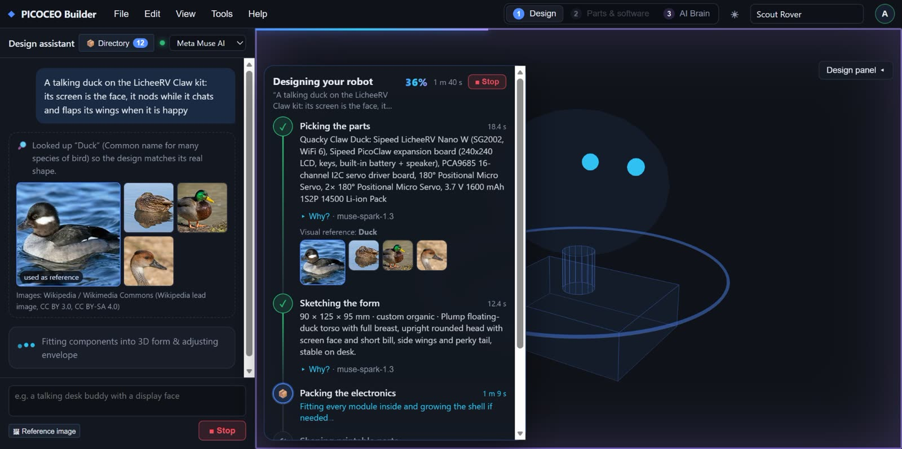
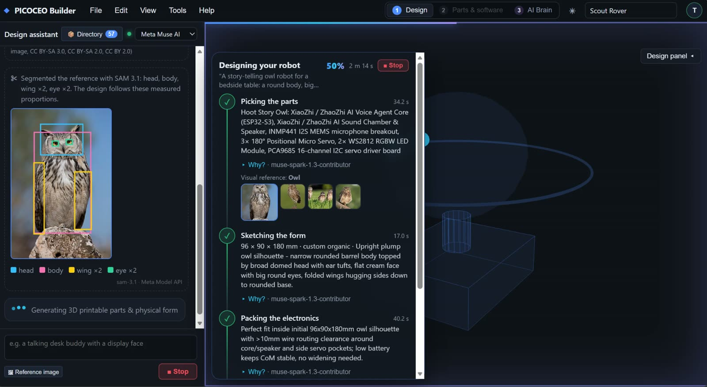
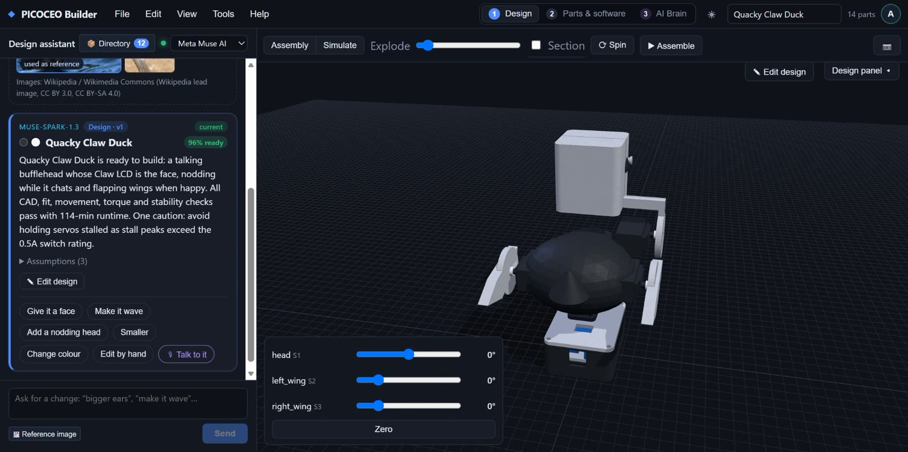
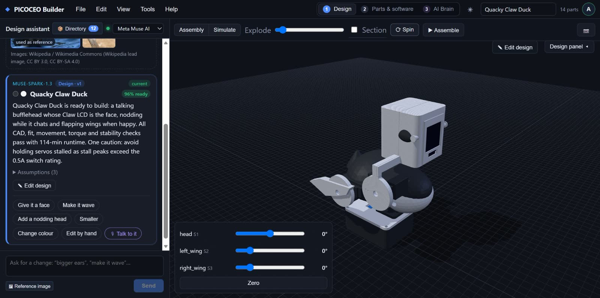
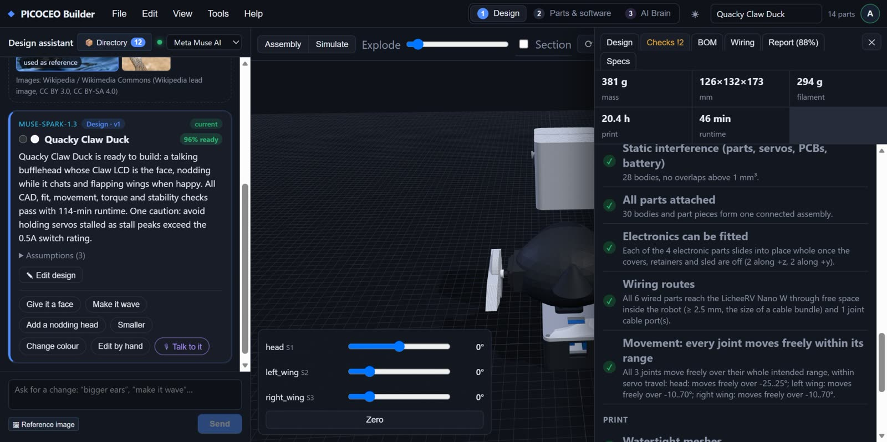
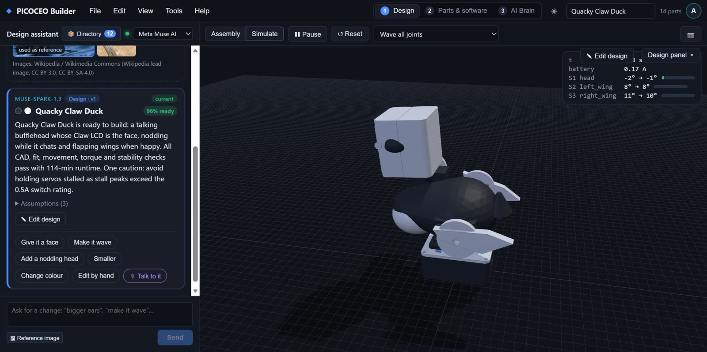
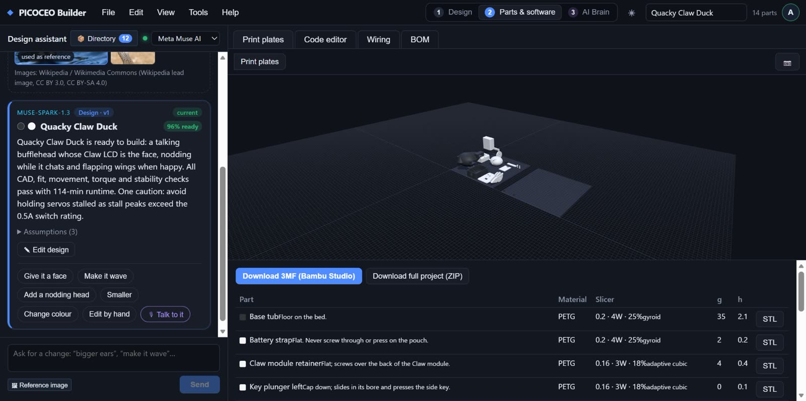
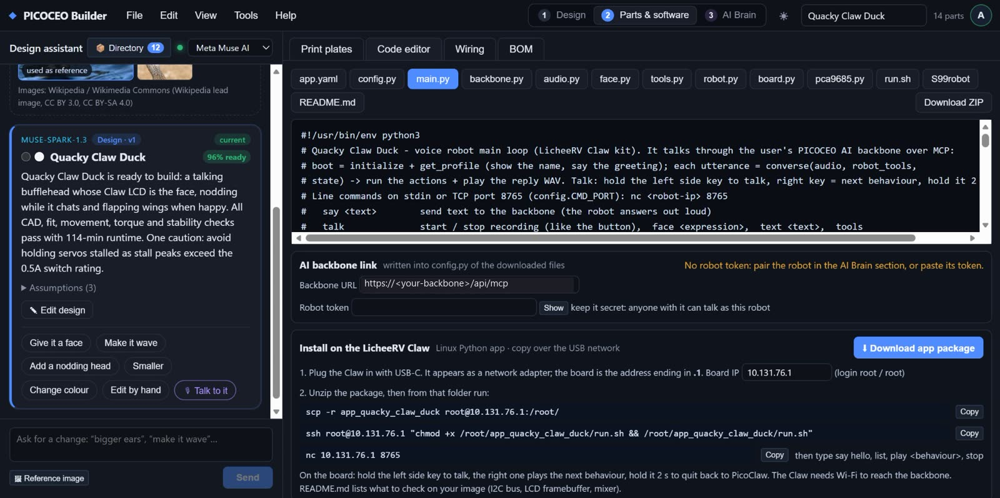
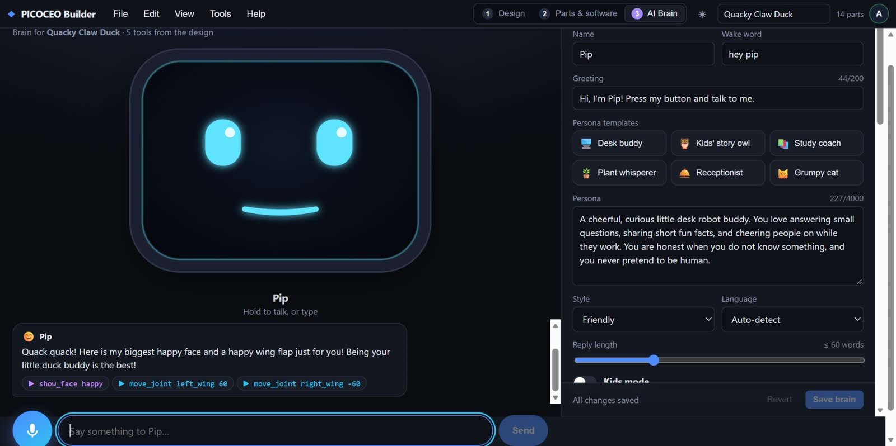
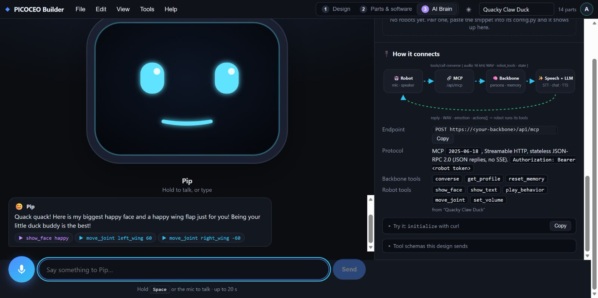

# PICOCEO Builder

**Describe a robot. Watch AI engineer it. Then talk to it.**

[PICOCEO.com](https://picoceo.com) gives one person online AI agents to run a whole company. Some of those agents need
an offline presence too: a receptionist at the door, a host at a trade-show booth, a desk assistant in a shop.
**PICOCEO Builder fills that gap.** It turns one sentence into a real robot body that you can print, wire and talk
to, and it connects that body to the same AI agent over MCP.

AI: **Meta Muse Spark** (`muse-spark-1.3-contributor`, Meta Model API)



## What it does

You type an idea, for example *"A talking duck on the LicheeRV Claw kit: its screen is the face, it nods while it
chats and flaps its wings when it is happy"*. An 8-step engineering agent then designs the whole machine:

| Step | What happens |
|---|---|
| 1 · Components | Muse picks parts from your own stock (CyberBrick, Sipeed LicheeRV Claw, XiaoZhi ESP32-S3, Raspberry Pi, Jetson) and looks up a visual reference. With *Use any parts* on, anything missing goes on a shopping list. |
| 2 · 3D form | The idea and the reference image become a silhouette built from 68 parametric shapes. |
| 3 · Packaging | The board, battery, screen, microphone and speaker are fitted inside the shell, which grows if needed. |
| 4 · Printable parts | A CAD composer (manifold-3d) builds watertight, screw-together parts with servo housings, horn seats, magnet-held covers and cable holes. |
| 5 · Engineering audit | About 25 checks on the real geometry: interference, attachment, insertion, wiring routes, joint movement, torque, centre of mass and walking balance. Failures go back to step 4. |
| 6 · Behaviours | Muse writes motion behaviours (nod, greet, walk), which play in a Rapier physics simulation. |
| 7 · Firmware | The robot app for the chosen board: MicroPython (ESP32) or Linux Python (LicheeRV Claw). |
| 8 · Sign-off | A final readiness verdict over the same checks. |

Every step calls Muse with a strict JSON schema, so the answer drives the CAD kernel directly. Each call is retried
on the same model (3 tries, 120 s each) rather than switched to a weaker one.

Three Meta models work together, all through the Meta Model API:

| Model | Where | What it does |
|---|---|---|
| **Muse Spark** (`muse-spark-1.3-contributor`) | All 8 design steps, and the robot's brain | Structured design reasoning, vision on the reference picture, fixes from the engineering checks, conversation and tool calls |
| **SAM 3.1** (`sam-3.1`) | Between steps 1 and 2 | Splits the reference picture into named parts (head, body, wing, tail, beak …). Their measured sizes and positions go to every later step, and the boxes are drawn over the picture in the chat |
| **Muse Voice Transcribe** (`muse-voice-transcribe-1.0`) | The MCP backbone | Speech-to-text for every voice turn a robot sends |



*SAM 3.1 on the reference photo for "a story-telling owl robot": head, body, two wings and two eyes. Muse then sketches
"a broad domed head with ear tufts, big round eyes, folded wings hugging the sides" from those measured proportions.*

## Screenshots

| | |
|---|---|
|  **The design, ready to build:** 14 parts, 3 joints, 96 % ready. |  **Exploded view:** every part comes apart. |
|  **Engineered, not just drawn:** insertion, wiring routes and joint movement are checked on the real geometry. |  **Physics simulation** with real servo torque and battery current. |
|  **Print plates** for Bambu Studio (3MF), per-part STL and a project ZIP. |  **The robot app** for the LicheeRV Claw, with install steps over USB. |
|  **AI brain:** Muse becomes the robot's personality, and its joints are tools it can call. |  **Pair any robot over MCP:** `converse`, `show_face`, `move_joint`, `play_behavior`. |

## How the robot connects

A paired robot calls the MCP backbone (`/api/mcp`, Streamable HTTP, JSON-RPC 2.0) with its robot token. The robot's
speech is transcribed by Muse Voice Transcribe, and each conversation turn runs on Muse Spark with the robot's persona, memory and its own tools. The robot's joints and behaviours
are exposed as MCP tools, so *"flap your wings if you're happy"* really moves the servos. Robot tokens are created in
**AI Brain → Robots → Pair a robot** and shown once. See [docs/BACKBONE_MCP.md](docs/BACKBONE_MCP.md).

## Quick start

```bash
npm install
```
```bash
npm run dev
```

Open http://localhost:5180. Copy `.env.local.example` to `.env.local` (git-ignored) and set `META_API_KEY` (Meta
Model API). The server reads the key; the browser never sees it. The model is `muse-spark-1.3-contributor` (override with
`META_MODEL`), and `META_TRIES` sets how often a call is retried. For production run `npm run build`, then `npm start`. Open `/?preview` in dev to use the app without Google sign-in.

## Tests

```bash
npm test
```

- `scripts/selftest.ts` builds 50 robot variants and fails on any geometry check.
- `scripts/simtest.ts` checks the physics: rovers drive, arms hold and stall, legs walk.
- `scripts/metamock.mjs` runs the AI endpoint against a local mock of the Meta
  Model API and checks the request shape, the strict schema and error handling.
- `scripts/metamediatest.mjs` checks the Muse Voice Transcribe and SAM 3.1 requests and answer parsing against a mock.
- `scripts/backbonetest.mjs` checks the MCP backbone.

## Layout

```
server/design.mjs      AI design endpoint (prompts, JSON schema, retries); synced to functions/ for Firebase
server/backbone.mjs    MCP backbone for paired robots (Muse Voice Transcribe speech-to-text)
server/segment.mjs     SAM 3.1 part segmentation of the reference picture
src/design/            spec, 8-step pipeline, checks, BOM, behaviours, firmware generators
src/cad/               CAD kernel helpers, composer, fit checks, archetype builders (Web Worker)
src/sim/physics.ts     Rapier simulation
src/viewer/            three.js viewport
src/ui/                React app
docs/                  CAD_BUILDERS.md, HARDWARE_DESIGN_STANDARD.md, BACKBONE_MCP.md, screenshots
```
